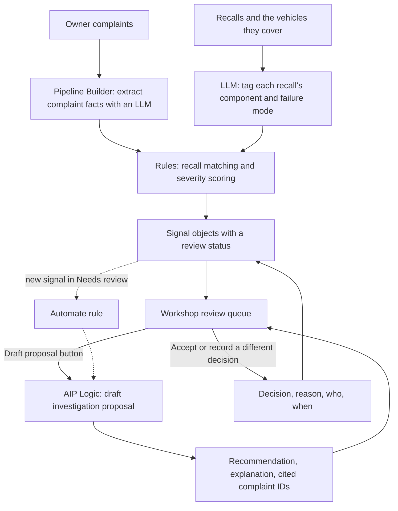
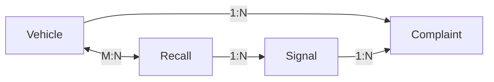

# Architecture

The app takes raw complaint text, turns it into structured facts, applies rules to decide what needs attention, and then has AIP draft a recommendation that an engineer accepts or overrules. Everything runs in Foundry: Pipeline Builder, the Ontology, Actions, AIP Logic, Workshop, and Automate.

The dotted path is the automation. It's set up and active, but it only fires when a new signal enters the queue, which hasn't happened since I created it, so in the demo I draft proposals with the button.

## 1. Extract facts from each complaint

The Complaint extraction pipeline has one LLM step, Extract complaint facts, running GPT-4.1 mini at temperature 0 with a structured output:

| Field | Type | What it's for |
|---|---|---|
| `component` | String | Which system failed (18 options) |
| `failure_mode` | String | One of 24 failure modes |
| `severity` | Integer | 1 to 4, feeds the scoring |
| `while_driving` | Boolean | Whether it happened with the car moving |
| `mileage` | Integer | Odometer at failure, 0 if not stated |
| `owner_mentions_recall` | Boolean | Whether the owner brings up a recall |
| `evidence_quote` | String | The sentence from the complaint that best supports the failure mode |

The full prompt is in [prompts/extraction-system-prompt.txt](../prompts/extraction-system-prompt.txt). After the LLM step, two rules clean up the output: if NHTSA's own data says there was a crash, fire, injury, or death, severity is forced to 4, and a mileage of 0 is turned into null. Errors go into an `llm_error` column instead of failing the build.

## 2. Match recalls and score signals

A second LLM step tags each recall with the same component and failure-mode lists. The prompt tells it to tag the part that's defective, not what happens because of it, so a cracked seat sensor is tagged as a sensor problem even though the result is an airbag that doesn't deploy correctly ([prompt](../prompts/recall-tagging-system-prompt.txt)).

Each complaint then gets a recall status:

- **Covered:** a recall for the same failure mode covers that exact vehicle (model and year).
- **Possible scope gap:** a recall for the same failure mode exists for the model, but not for this model year.
- **Not covered:** nothing matches.

Covered complaints and complaints tagged `other` are dropped. Everything else is grouped by model and failure mode into a signal and scored:

| Severity | Points |
|---:|---:|
| 4 | 15 |
| 3 | 5 |
| 2 | 2 |
| anything else | 1 |

A signal is **Needs review** when its score is at least 30 and it has at least 5 complaints; otherwise it's **Monitoring**. I picked those thresholds by judgment, not by tuning them against data. The pipeline also works out the first date a signal crossed the threshold, which shows up in the app as "Above threshold since". The details, with line numbers in the exported Java, are in [logic/README.md](../logic/README.md).

## 3. The ontology

There are four object types: **Vehicle** (one make, model, and year), **Complaint**, **Signal**, and **Recall**.

All the properties and Actions are listed in [ontology.md](ontology.md).

## 4. Draft a proposal with AIP Logic

The Draft investigation proposal function takes one Signal and returns `recommended_action`, `summary`, and `cited_complaint_ids`. The prompt defines when to pick each action:

- **Open investigation:** one clear safety-related failure plus real harm or a sustained pattern (at least one crash, fire, or injury, or at least 20 serious complaints).
- **Review recall scope:** the signal is a possible scope gap.
- **Keep monitoring:** everything else.

It's told to use only the facts it's given, cite 3 to 5 complaint IDs from the evidence list, and never say a defect is confirmed. A Save proposal step writes the output to the Signal's AIP fields and doesn't touch the decision fields. [Prompt](../prompts/proposal-system-prompt.txt)

## 5. Record the engineer's decision

The Workshop app has four tabs: Review queue, Decisions, Spot check, and Recalls. The engineer picks a signal, reads the proposal and the complaints behind it, and either accepts it or records a different decision with a reason and optional notes. The decision, reason, name, and time are saved on the Signal next to the AIP proposal. See [decision-workflow.md](decision-workflow.md).
