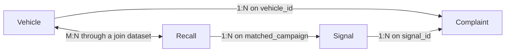

# Ontology

This is everything in [ontology-project.json](../exports/ontology-project.json), which I exported from Ontology Manager and trimmed to just this project. My Foundry account also had Palantir's example objects in it (15 object types total), so I took those out and kept the 4 object types, 4 links, and 6 Actions that belong to this app. The file has the schema and Action definitions, not the data itself.

## Object types

| API name | Primary key | Title | Properties |
|---|---|---|---:|
| `Complaint` | `complaint_id` | `complaint_id` | 30 |
| `Signal` | `signal_id` | `signal_name` | 29 |
| `Recall` | `campaign_number` | `campaign_number` | 10 |
| `Vehicle` | `vehicle_id` | `display_name` | 5 |

## Links

| Link | Type | API names | Joined on |
|---|---|---|---|
| Vehicle to Complaint | one to many | `complaints` / `vehicle` | `Vehicle.vehicle_id` = `Complaint.vehicle_id` |
| Signal to Complaint | one to many | `complaints` / `signal` | `Signal.signal_id` = `Complaint.signal_id` |
| Recall to Signal | one to many | `signals` / `relatedRecall` | `Recall.campaign_number` = `Signal.matched_campaign` |
| Vehicle to Recall | many to many | `recalls` / `vehiclesCovered` | Join dataset of `vehicle_id` and `campaign_number` |

## Actions

| Action | Object | What it does |
|---|---|---|
| `draft-proposal-with-aip` | Signal | Runs the Draft investigation proposal function (v1.1.0) on the selected signal |
| `save-proposal` | Signal | Writes `proposal_action`, `proposal_summary`, and `proposal_evidence`, and sets `proposal_drafted_at` to now. Doesn't touch the decision fields. |
| `record-decision` | Signal | Writes `decision`, `decision_reason`, and `decision_notes`, and sets `decided_by` to the current user and `decided_at` to now. Doesn't touch the AIP fields. |
| `reopen-signal` | Signal | Clears the five decision fields so the signal goes back in the queue |
| `review-extraction` | Complaint | Saves a spot-check verdict and an optional corrected failure mode, keeping the original `failure_mode` as is |
| `reset-for-demonstration` | Signal | Clears the decisions on Unexpected Braking, Driver Assist Fault, and Airbag Deployment Problem, and resets the Airbag proposal, so I can run the demo again from the same starting point |

### Dropdown values

- **AIP proposed action:** Open investigation, Review recall scope, Keep monitoring
- **Decision:** Open investigation, Review recall scope, Keep monitoring, Close: not a safety issue
- **Decision reason:** Agrees with AIP proposal, Not a safety issue, Already covered by a recall, Duplicate of another signal, Needs more data, Other
- **Spot-check verdict:** Correct, Wrong failure mode, Not a vehicle defect

Decision and reason are required; notes are optional.

## Properties

### Complaint

One owner complaint, with the fields AIP extracted, its recall match, and the spot-check review fields.

| Property ID | API name | Base type | Display label |
|---|---|---|---|
| `complaint_id` (primary key) | `complaintId` | `INTEGER` | Complaint ID |
| `component` | `component` | `STRING` | Component (AIP) |
| `corrected_failure_mode` | `correctedFailureMode` | `STRING` | Corrected failure mode |
| `covered_since` | `coveredSince` | `DATE` | Covered since |
| `crash` | `crash` | `BOOLEAN` | Crash reported |
| `date_filed` | `dateFiled` | `DATE` | Date filed |
| `date_of_incident` | `dateOfIncident` | `DATE` | Incident date |
| `deaths` | `deaths` | `INTEGER` | Deaths |
| `evidence_quote` | `evidenceQuote` | `STRING` | Evidence quote (AIP) |
| `failure_mode` | `failureMode` | `STRING` | Failure mode (AIP) |
| `fire` | `fire` | `BOOLEAN` | Fire reported |
| `injuries` | `injuries` | `INTEGER` | Injuries |
| `llm_error` | `llmError` | `STRING` | AIP extraction error |
| `make` | `make` | `STRING` | Make |
| `matched_campaign` | `matchedCampaign` | `STRING` | Matched recall |
| `mileage` | `mileage` | `INTEGER` | Mileage (AIP) |
| `model` | `model` | `STRING` | Model |
| `model_year` | `modelYear` | `INTEGER` | Model year |
| `nhtsa_components` | `nhtsaComponents` | `STRING` | NHTSA components |
| `owner_mentions_recall` | `ownerMentionsRecall` | `BOOLEAN` | Owner mentions recall (AIP) |
| `recall_status` | `recallStatus` | `STRING` | Recall status |
| `related_since` | `relatedSince` | `DATE` | Related recall since |
| `review_verdict` | `reviewVerdict` | `STRING` | Review verdict |
| `severity` | `severity` | `INTEGER` | Severity (AIP) |
| `severity_weight` | `severityWeight` | `INTEGER` | Severity weight |
| `signal_id` | `signalId` | `STRING` | Signal ID |
| `spot_check` | `spotCheck` | `BOOLEAN` | In spot-check sample |
| `summary` | `summary` | `STRING` | Complaint text |
| `vehicle_id` | `vehicleId` | `STRING` | Vehicle ID |
| `while_driving` | `whileDriving` | `BOOLEAN` | While driving (AIP) |

### Signal

A group of complaints with the same model and failure mode, with its totals, recall status, AIP proposal, and the engineer's decision.

| Property ID | API name | Base type | Display label |
|---|---|---|---|
| `complaint_count` | `complaintCount` | `LONG` | Complaints |
| `crash_or_fire_count` | `crashOrFireCount` | `LONG` | Crashes or fires |
| `death_count` | `deathCount` | `LONG` | Deaths |
| `decided_at` | `decidedAt` | `TIMESTAMP` | Decided at |
| `decided_by` | `decidedBy` | `STRING` | Decided by |
| `decision` | `decision` | `STRING` | Decision |
| `decision_notes` | `decisionNotes` | `STRING` | Decision notes |
| `decision_reason` | `decisionReason` | `STRING` | Decision reason |
| `evidence_sample` | `evidenceSample` | `STRING` | Evidence sample |
| `failure_mode` | `failureMode` | `STRING` | Failure mode |
| `first_seen` | `firstSeen` | `DATE` | First complaint |
| `flagged_since` | `flaggedSince` | `DATE` | Above threshold since |
| `injury_count` | `injuryCount` | `LONG` | Injuries |
| `last_seen` | `lastSeen` | `DATE` | Latest complaint |
| `make` | `make` | `STRING` | Make |
| `matched_campaign` | `matchedCampaign` | `STRING` | Related recall |
| `matched_recall_years` | `matchedRecallYears` | `STRING` | Related recall model years |
| `model` | `model` | `STRING` | Model |
| `model_years` | `modelYears` | `STRING` | Model years |
| `proposal_action` | `proposalAction` | `STRING` | AIP proposed action |
| `proposal_drafted_at` | `proposalDraftedAt` | `TIMESTAMP` | AIP proposal drafted at |
| `proposal_evidence` | `proposalEvidence` | `STRING` | AIP cited complaints |
| `proposal_summary` | `proposalSummary` | `STRING` | AIP proposal |
| `recall_status` | `recallStatus` | `STRING` | Recall status |
| `serious_count` | `seriousCount` | `LONG` | Serious complaints |
| `severity_score` | `severityScore` | `LONG` | Severity score |
| `signal_id` (primary key) | `signalId` | `STRING` | Signal ID |
| `signal_name` | `signalName` | `STRING` | Signal |
| `status` | `status` | `STRING` | Status |

### Recall

An NHTSA recall for the Accord, tagged with the same failure-mode list as the complaints.

| Property ID | API name | Base type | Display label |
|---|---|---|---|
| `campaign_number` (primary key) | `campaignNumber` | `STRING` | Campaign Number |
| `consequence` | `consequence` | `STRING` | Consequence |
| `model_years_covered` | `modelYearsCovered` | `STRING` | Model years covered |
| `nhtsa_component` | `nhtsaComponent` | `STRING` | NHTSA component |
| `recall_component` | `recallComponent` | `STRING` | Component (AIP tag) |
| `recall_failure_mode` | `recallFailureMode` | `STRING` | Failure mode (AIP tag) |
| `remedy` | `remedy` | `STRING` | Remedy |
| `report_received_date` | `reportReceivedDate` | `DATE` | Report received |
| `summary` | `summary` | `STRING` | Summary |
| `tag_error` | `tagError` | `STRING` | Tag Error |

### Vehicle

One make, model, and year, like a 2018 Honda Accord. Complaints and recalls link to it.

| Property ID | API name | Base type | Display label |
|---|---|---|---|
| `display_name` | `displayName` | `STRING` | Display Name |
| `make` | `make` | `STRING` | Make |
| `model` | `model` | `STRING` | Model |
| `model_year` | `modelYear` | `INTEGER` | Model Year |
| `vehicle_id` (primary key) | `vehicleId` | `STRING` | Vehicle Id |

`Signal.model_years`, `Recall.model_years_covered`, and `Signal.proposal_evidence` are comma-separated strings, not arrays.
